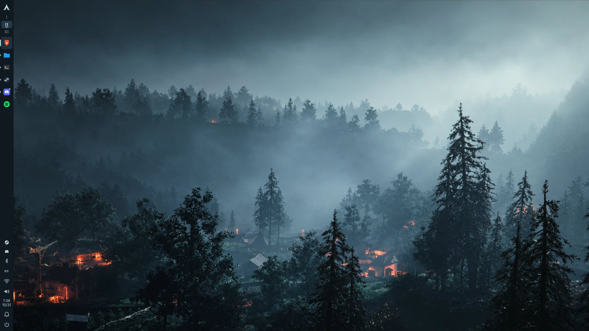
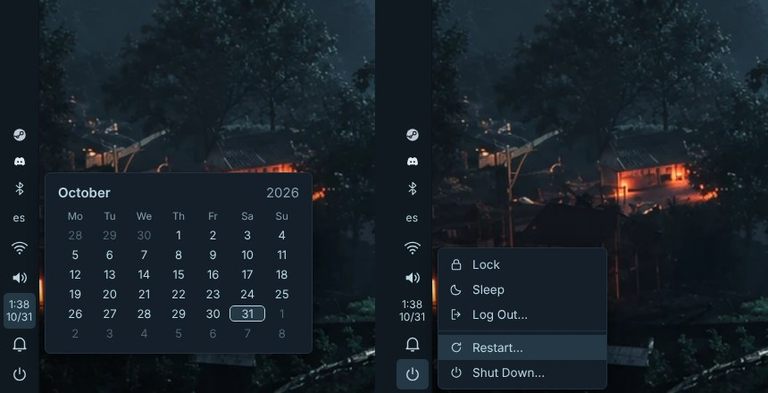

# Empire Plasma — Mist Edition

Dotfiles minimalistas para **CachyOS + KDE Plasma 6**, pensados para un PC de juego (Age of Empires II: DE, Steam, OBS).
Una sola barra vertical a la izquierda, fina y opaca, con colores sacados del wallpaper del bosque con niebla, y nada que consuma CPU en segundo plano.





> **Sobre las imágenes:** son una **maqueta renderizada** (HTML + tu wallpaper) con las medidas y colores reales del tema.
> No son una captura de Plasma: este repositorio se escribió y probó en un contenedor sin escritorio KDE.
> Mira [Estado de verificación](#estado-de-verificación) para saber qué está probado y qué tienes que comprobar tú.

---

## Qué hace

Barra vertical de 44 px en el borde izquierdo, de arriba abajo:

| Zona | Contenido | Componente |
|---|---|---|
| Arriba | Logo de Arch (azul niebla) → lanzador de apps | Kickoff nativo con icono propio |
| | `I` `II` `III` apilados (Dark / Feudal / Castle Age) | **Empire Ages** (QML propio) |
| | Apps ancladas y abiertas, con **su icono original** | Gestor de tareas nativo de Plasma |
| Medio | Espacio libre | Espaciador nativo |
| Abajo | Bandeja: Steam, Discord, Bluetooth, Dropbox, Nextcloud… | Bandeja del sistema nativa |
| | Teclado · Wi-Fi/red · Volumen · Batería (solo si hay) | Applets nativos de Plasma |
| | Hora sobre fecha (`1:38` / `10/31`), clic → calendario | **Empire Clock** (QML propio) |
| | Notificaciones | Applet nativo de Plasma |
| | ⏻ al final de todo → Bloquear, Suspender, Cerrar sesión, Reiniciar, Apagar | **Empire Power** (QML propio) |

El indicador de teclado muestra lo que tengas configurado en el sistema: el instalador no toca tus distribuciones de teclado. Los iconos de las apps son los que trae cada app; el tema no les cambia el color.

Además:

- **Esquema de color `Empire Mist`** para Plasma y todas las apps (Dolphin, Preferencias del sistema, menús, notificaciones, calendario).
- **KWin:** decoración Breeze discreta, bordes mínimos, botones `minimizar · maximizar · cerrar`, sin blur, sin transparencias y sin efectos de ventanas gelatinosas.
- **Konsole:** perfil `Empire Mist`, fondo opaco `#101820`, cursor fino, sin barra de desplazamiento.
- **Prompt** para bash, zsh y fish: `Λ ~/proyectos ›`. Si un comando falla, muestra el código: `Λ ~/proyectos ×127 ›`.
- **Escritorios virtuales:** exactamente tres, llamados *Dark Age*, *Feudal Age* y *Castle Age*. Los nombres solo aparecen en tooltips, en Vista general y en el OSD. La barra solo muestra los números romanos.

No se tocan: wallpaper, distribuciones de teclado, iconos de las apps, kernel, drivers, Steam, Proton, Gamescope, OBS, energía, arranque, servicios ni fuentes del sistema.

### Paleta

| Token | Color | Uso |
|---|---|---|
| base | `#101820` | Fondo dominante: barra, ventanas, cabeceras, terminal |
| view | `#141F29` | Fondo de listas y vistas (Dolphin) |
| slate | `#253846` | Selección, escritorio activo, elemento pulsado |
| mist | `#B8D5E0` | Texto e iconos (contraste 11,6:1 sobre la base) |
| mist-dim | `#86A0AC` | Texto inactivo (6,5:1, cumple WCAG AA) |
| mist-bright | `#DCEBF1` | Texto seleccionado |

Los colores *semánticos* (error, aviso, OK) y los 16 colores ANSI de Konsole se mantienen, aunque desaturados hacia la niebla. Sin ellos no se distinguirían un `git diff` ni un error. Ningún elemento decorativo usa dorado, borgoña, morado ni neón.

---

## Requisitos y dependencias

Todo viene con una instalación normal de CachyOS KDE. **No se instala ningún paquete.**

| Necesario | Paquete Arch | Para qué |
|---|---|---|
| Plasma ≥ 6.2 (recomendado ≥ 6.4) | `plasma-workspace`, `plasma-desktop`, `libplasma` | Barra, applets, API de scripting |
| KWin | `kwin` | Escritorios, decoración |
| Breeze | `breeze` | Estilo de apps y decoración |
| Konsole | `konsole` | Perfil de terminal |
| `kwriteconfig6`, `kreadconfig6` | `kconfig` | Escribir/leer configuración |
| `kquitapp6` | `kde-cli-tools` | Reiniciar plasmashell limpiamente |
| `busctl` | `systemd` | D-Bus (sin depender de `qdbus6`) |
| `fc-list` | `fontconfig` | Elegir fuente monoespaciada |
| Opcional: `kscreen-doctor` | `kscreen` | Mostrar monitores en el informe |

Para el terminal se usa la primera fuente instalada de esta lista: JetBrains Mono, Hack, Fira Code, Noto Sans Mono o DejaVu Sans Mono.

---

## Instalación

```bash
git clone https://github.com/dani3lsamir/aoe-plasma.git empire-plasma
cd empire-plasma
./install.sh --dry-run     # solo detecta y enseña qué cambiaría
./install.sh               # pregunta antes de cada cambio importante
```

El instalador sigue estos pasos:

1. **Detecta** la versión de CachyOS y de Plasma, si la sesión es Wayland o X11, los monitores, los paneles y escritorios actuales, el esquema de color, si Brave Origin está instalado, si hay batería y tu shell.
2. **Muestra** la lista completa de cambios.
3. **Pregunta** antes de aplicar nada. Además pregunta aparte antes de *borrar tus paneles actuales* y de quitar escritorios sobrantes.
4. **Hace una copia de seguridad** en `~/.local/share/empire-plasma/backups/<fecha>/`. La primera copia queda marcada como *original*: aunque reinstales, `restore.sh` vuelve siempre a tu escritorio de antes de Empire.
5. **Aplica** los cambios y reinicia `plasmashell` una vez (la pantalla parpadea un segundo).
6. **Verifica** lo que se puede comprobar con un script (ver abajo) e informa de cualquier fallo.

Opciones:

```
--dry-run        detectar y previsualizar, sin cambios
-y, --yes        responder "sí" a todo (igualmente hace la copia)
--keep-panels    añadir la barra sin quitar los paneles actuales
--no-panel       solo tema, KWin, Konsole y prompt
--no-shell       no tocar bash/zsh/fish
--no-desktops    no cambiar número/nombres de escritorios
--thickness 44   ancho de la barra en px (36–64)
```

### Restaurar

```bash
./restore.sh            # vuelve al estado anterior a la primera instalación
./restore.sh --list     # lista las copias
./restore.sh --from ~/.local/share/empire-plasma/backups/20261026-231520
```

Qué recupera:

- Los paneles (y con ellos el wallpaper de ese momento) y `plasmashellrc`.
- Cada ajuste que el instalador cambió, **clave por clave**, así que se conservan los cambios que hayas hecho después en otras opciones.
- El esquema de color y el estilo de Plasma.
- El número y los nombres de los escritorios virtuales.
- Tu `.bashrc`, `.zshrc` o `config.fish` sin el bloque del prompt.

También borra los widgets, el esquema y el perfil instalados. Las copias de seguridad se conservan hasta que las borres tú.

---

## Por qué hay QML propio

La prioridad es usar componentes nativos. Solo hay QML propio donde Plasma no ofrece lo que pide el diseño:

| Widget | Por qué no basta el nativo | Coste en ejecución |
|---|---|---|
| **Empire Ages** | El *Paginador* dibuja escritorios en miniatura con contornos de ventanas. No tiene un modo "solo números romanos con cápsula y subrayado". | Señales de KWin vía `libtaskmanager`. Al hacer clic, una llamada D-Bus asíncrona. Sin temporizadores. |
| **Empire Clock** | En formato de 12 horas, el *Reloj digital* siempre añade "AM/PM" (`1:38 PM`), que no cabe en una barra estrecha ni es el aspecto pedido (`1:38` sobre `10/31`). | Un tic por minuto, del mismo origen que el reloj nativo (`org.kde.plasma.clock` en Plasma ≥ 6.6; motor `time` en versiones anteriores). El calendario es el `MonthView` de KDE y se crea al abrirlo por primera vez. |
| **Empire Power** | *Bloquear/Cerrar sesión* pone un icono por acción. | `SessionManagement` de Plasma. Reiniciar y apagar muestran la confirmación nativa. |

Todo lo demás es nativo: el lanzador, las apps (con su indicador de app abierta y activa, y los avisos de notificación), la bandeja, el teclado, la red, el volumen, la batería y las notificaciones.

Todos leen sus colores del esquema de color: si lo cambias, la barra cambia con él. No hay colores fijos en el QML.

---

## Uso diario

### Aplicaciones

Es el gestor de tareas de Plasma, así que funciona como siempre:

- **Anclar:** clic derecho sobre una app abierta → *Anclar al gestor de tareas*, o arrástrala desde el menú de Arch hasta la barra.
- **Desanclar:** clic derecho → *Desanclar del gestor de tareas*.
- La app activa lleva fondo y una línea en el borde izquierdo; las abiertas, un indicador pequeño. Los avisos de notificación aparecen sobre el icono.

Al inicio solo se ancla Brave Origin, y solo si el instalador lo encuentra.

### Escritorios

Clic en `I`, `II` o `III`. La rueda del ratón sobre los números también cambia de escritorio. Para renombrar las "edades": *Preferencias del sistema → Escritorios virtuales*.

### Teclado

El indicador muestra y alterna las distribuciones que tengas en *Preferencias del sistema → Teclado*. El tema no las cambia.

---

## Personalizar colores y tamaños

**Colores:** edita `config/color-schemes/EmpireMist.colors` (formato `R,G,B`) y vuelve a ejecutar `./install.sh`, o aplica a mano:

```bash
cp config/color-schemes/EmpireMist.colors ~/.local/share/color-schemes/
plasma-apply-colorscheme BreezeDark && plasma-apply-colorscheme EmpireMist
```

Qué controla cada grupo del esquema:

| Grupo | Afecta a |
|---|---|
| `[Colors:Window]` / `[Colors:Header]` `BackgroundNormal` | La barra y el fondo de las ventanas |
| `[Colors:Selection]` `BackgroundNormal` | La cápsula del escritorio activo y las selecciones de Dolphin |
| `ForegroundNormal` | Texto e iconos (el azul niebla) |
| `ForegroundInactive` | Números de escritorios inactivos y texto apagado |

Los colores de Konsole están en `config/konsole/EmpireMist.colorscheme`. Los del prompt, al principio de `config/shell/prompt.*`.

**Tamaños:**

- **Ancho de la barra:** `./install.sh --thickness 48`, o *clic derecho en la barra → Mostrar configuración del panel → Ancho*. Plasma deja 4 px a cada lado, así que en una barra de 44 px cada widget tiene 36 px; los números romanos, el reloj y el apagado se escalan con ese ancho.
- **Ajustes guardados por widget** en `~/.config/plasma-org.kde.plasma.desktop-appletsrc` (se aplican al reiniciar Plasma: `systemctl --user restart plasma-plasmashell`):

| Widget | Clave | Por defecto | Qué hace |
|---|---|---|---|
| Empire Clock | `dateFormat` | `M/d` | Formato de la fecha: `M/d` da `10/31`, `d/M` da `31/10` |
| Empire Clock | `twentyFourHour` | `false` | Formato de 24 horas |
| Empire Clock | `showAmPm` | `false` | Añade `A` o `P` a la hora (`1:38 P`) |
| Empire Clock | `fontScale` | `0.34` | Tamaño del texto respecto al ancho del widget (≈ 12 px en una barra de 44 px) |
| Empire Ages | `fontFamily` | `serif` | Fuente de los números romanos (vacío = fuente de Plasma) |

---

## Rendimiento

- No se instala nada que se quede ejecutándose: ni barra externa, ni Conky, ni monitores, ni scripts en bucle.
- Ningún widget sondea. Todos reaccionan a señales: KWin, la sesión de Plasma y un tic de reloj por minuto.
- El compositor queda como estaba. Solo se desactivan blur, background contrast, translucency, wobbly windows y magic lamp. Los juegos a pantalla completa siguen pasando por KWin igual que antes. En Wayland, KWin ya usa scan-out directo para pantalla completa.
- **No prometo más FPS.** Quitar blur y transparencias reduce trabajo del compositor en el escritorio, pero no he medido diferencias en juegos. Si quieres datos, compara con MangoHud antes y después.

---

## Estado de verificación

**Comprobado aquí** (contenedor Linux sin escritorio, con las herramientas KDE simuladas):

- `shellcheck` sin avisos en `install.sh`, `restore.sh`, `lib/common.sh` y el prompt de bash.
- Los widgets propios se ejecutaron en un motor Qt 6.9 real, dentro de una barra simulada de 44 px que copia las reglas de tamaño del panel de Plasma 6.4, con clics de ratón reales (30/30 comprobaciones):
  - `I II III` apilados justo debajo del logo, de 36 × 24 px, con números de 12 px; el clic cambia de escritorio en KWin;
  - el reloj muestra dos líneas centradas (`4:27` sobre `10/26`), cabe en 36 px y abre el calendario a la derecha de la barra;
  - el apagado es lo último de la barra, su menú se abre a la derecha y cada opción llega a la sesión de Plasma;
  - nada se solapa y no hay avisos de QML.
- En Plasma 6.0–6.5 el reloj usa la fuente de hora anterior y funciona.
- El script de la barra crea el panel a la izquierda, opaco, sin flotar, con los widgets en este orden: Arch · I II III · apps · espacio · bandeja · teclado · red · volumen · (batería) · reloj · notificaciones · apagado.
- Ciclo completo *instalar → reinstalar → restaurar* en un HOME temporal con herramientas KDE simuladas:
  - el wallpaper no se toca y el teclado tampoco;
  - los escritorios pasan de 4 a 3 y vuelven a 4 con sus nombres;
  - la reinstalación conserva la copia original;
  - tras restaurar, el HOME queda **idéntico byte a byte**.
- Los prompts de bash, zsh 5.9 y fish 3.7 se renderizan bien, también con código de error.
- Las APIs usadas se revisaron contra el código fuente de Plasma 6.2, 6.4, 6.5, 6.6 y master.

**Por comprobar en tu PC.** Ningún script puede verlo; el instalador te lo recuerda. Marca cada punto:

- [ ] La barra está a la izquierda, es fina, completamente opaca y sin bordes llamativos.
- [ ] El logo de Arch abre el lanzador.
- [ ] `I`, `II` y `III` cambian de escritorio; la cápsula sigue al escritorio activo.
- [ ] Las apps muestran su icono original; la activa se distingue; anclar y desanclar funciona.
- [ ] La bandeja muestra Steam, Discord y similares cuando están abiertos.
- [ ] Teclado, Wi-Fi, volumen y batería (si hay) funcionan.
- [ ] El reloj muestra hora y fecha; el clic abre el calendario, y `Esc` lo cierra.
- [ ] ⏻ está al final de todo y bloquea, cierra sesión, reinicia y apaga (con confirmación).
- [ ] No hay iconos cortados ni desalineados.
- [ ] Steam, AoE II: DE y OBS (captura de pantalla y de juego) funcionan igual que antes.
- [ ] `./restore.sh` devuelve tu escritorio anterior.

Si algo falla, abre un issue con la salida de `./install.sh` y de `journalctl --user -b -u plasma-plasmashell | grep -i empire`.

---

## Estructura

```
empire-plasma/
├── install.sh                  detección → vista previa → copia → aplicar → verificar
├── restore.sh                  deshace todo desde la copia original
├── lib/common.sh               utilidades compartidas (KConfig, D-Bus, copias)
├── assets/empire-arch.svg      logo de Arch en azul niebla
├── config/
│   ├── color-schemes/EmpireMist.colors
│   ├── konsole/                EmpireMist.profile + EmpireMist.colorscheme
│   └── shell/                  prompt.bash · prompt.zsh · prompt.fish
├── plasma/
│   ├── layout/empire-panel.js  la barra, con la API de scripting de Plasma 6
│   └── plasmoids/              los 3 widgets Empire (QML): ages, clock, power
└── docs/                       imágenes de vista previa
```

## Solución de problemas

- **Aparece un widget como "no disponible":** tu Plasma no incluye ese applet. La barra se crea igualmente sin él.
- **La barra vieja sigue ahí:** respondiste "no" a reemplazar paneles. Bórrala con *clic derecho → Mostrar configuración del panel → Más opciones → Eliminar panel*.
- **El indicador I II III no cambia de escritorio:** necesita Plasma ≥ 6.2, que trae el módulo QML `org.kde.plasma.workspace.dbus`.
- **CachyOS muestra fastfetch al abrir fish:** es el saludo de CachyOS, no de este tema. Para quitarlo, añade `function fish_greeting; end` a `~/.config/fish/config.fish`.

## Licencia

MIT. Consulta [LICENSE](LICENSE).

El logo de Arch Linux procede de [Simple Icons](https://simpleicons.org) (CC0). El nombre y el logo de Arch Linux son marcas del proyecto Arch Linux y se usan según su política de marcas para uso comunitario.
